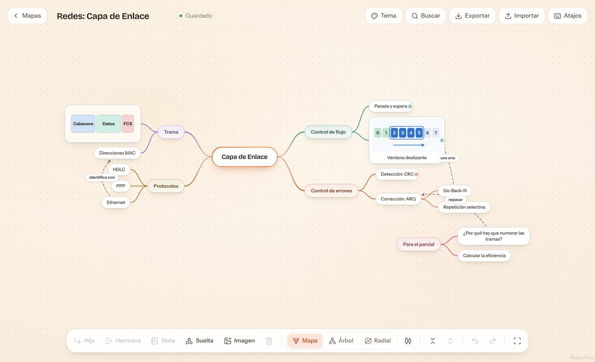
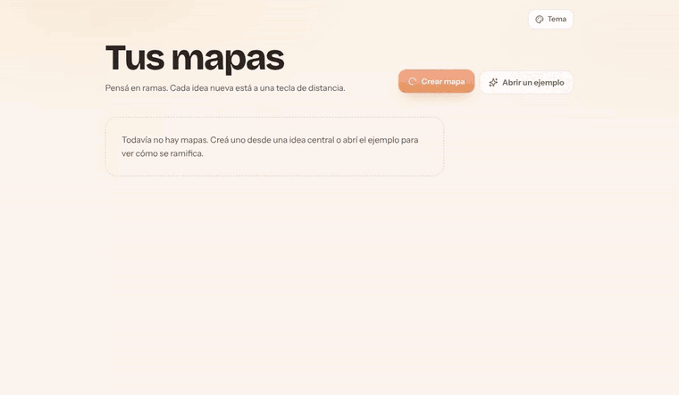
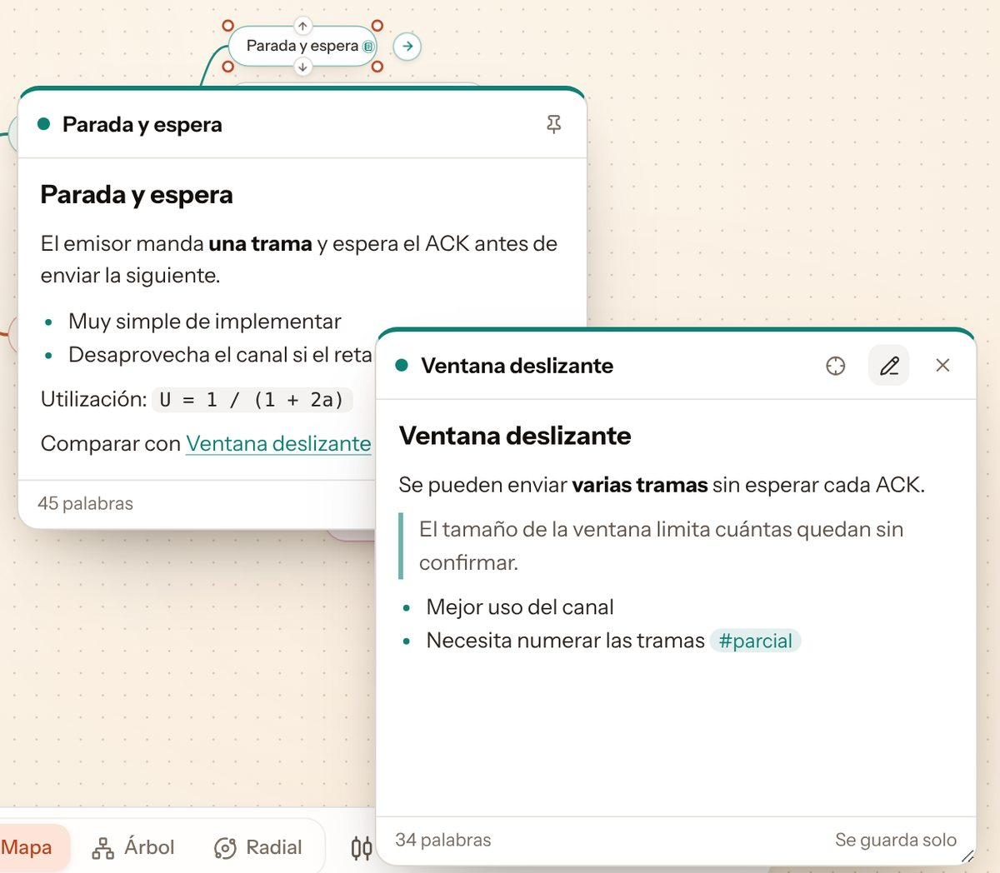
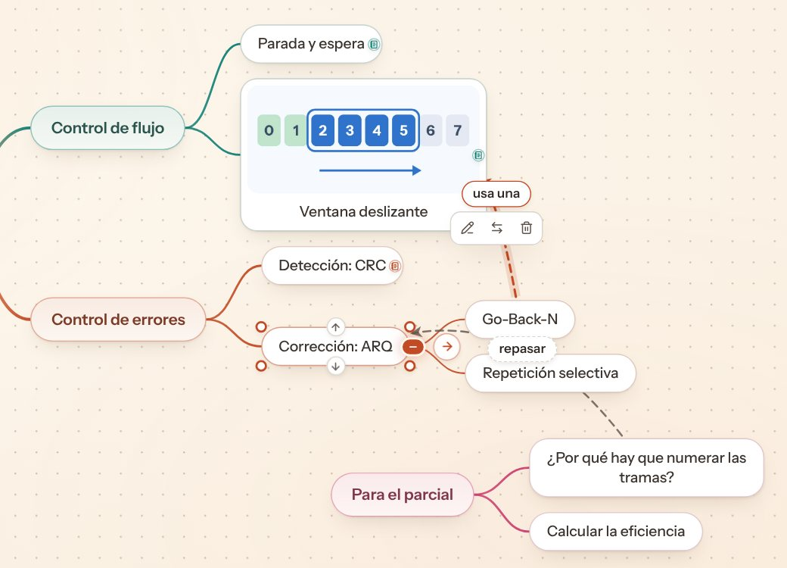
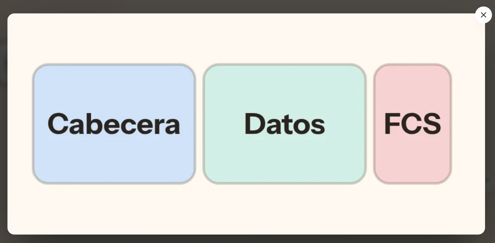
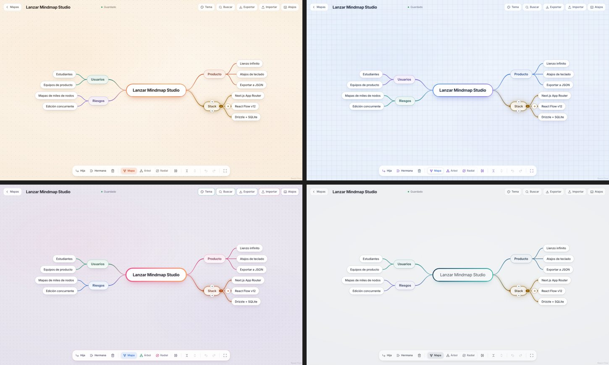
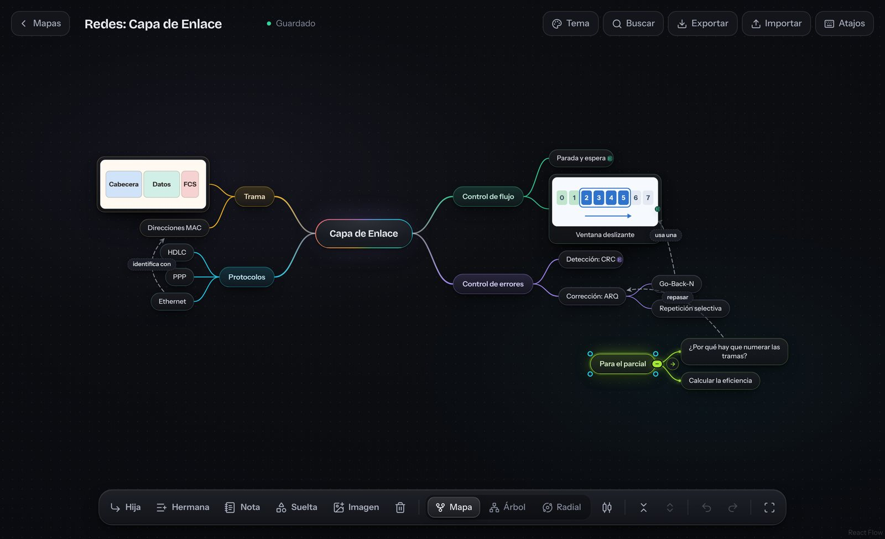

# Mindmap Studio MCM (My Confused Mind)

Editor de mapas mentales en el navegador, pensado para **estudiar y repasar**. Armás un tema con el teclado tan rápido como escribís una lista; le sumás notas, imágenes y flechas entre ideas; y después lo plegás y desplegás de a un nivel para autoevaluarte.



<p align="center">
  
</p>

## Novedades

| | Qué se agregó |
|---|---|
| 📝 | **Notas por idea** con vista previa al pasar el cursor, al estilo Obsidian, y ventanas flotantes para escribirlas |
| ↗️ | **Flechas de relación con nombre** entre dos ideas cualesquiera, aunque estén en ramas distintas |
| 🖼️ | **Imágenes dentro de las ideas**: botón, `Ctrl V` o arrastrar un archivo |
| 🫧 | **Ideas sueltas (flotantes)** que no cuelgan de la idea central y pueden tener su propia rama |
| 🎨 | Cada rama principal estrena color, también cuando se crea con `Enter` |

## Funciones

### Teclado primero

`Tab` crea una idea hija, `Enter` una hermana y tipear sobre una idea reemplaza su texto. Las flechas recorren el mapa y `F2` (o doble clic) renombra. Todo también se puede hacer con el mouse desde la barra de abajo. Hay tres distribuciones automáticas, **mapa**, **árbol** y **radial**, con transiciones animadas.

### Notas por idea

Cada idea puede tener una nota en Markdown: títulos, listas, citas, **negrita**, `código`, `[[enlaces]]` y `#etiquetas`.

- **Vista previa:** al dejar el cursor sobre una idea con nota aparece una tarjeta con la nota formateada. Las ideas con nota llevan un iconito a la derecha.
- **Ventana fijada:** un clic en la vista previa la convierte en una ventana flotante para escribir ahí mismo. Se arrastra, se agranda, se guarda sola y se puede pasar a modo lectura. Puede haber hasta 4 abiertas.
- **Nota nueva:** botón **Nota** de la barra o `Ctrl Enter` con la idea elegida. En la nota, `Tab` sangra las listas y `Esc` cierra.
- **Búsqueda:** `Ctrl F` también encuentra texto dentro de las notas.



### Flechas de relación

Para unir dos ideas que no están en la misma rama:

1. Pasá el cursor por una idea: aparecen **puntos en sus esquinas**.
2. Arrastrá uno de esos puntos hasta otra idea. Podés soltarlo en cualquier parte de ella.
3. Escribí el nombre de la relación (por ejemplo "usa una"). Se ve sobre la flecha punteada.

Clic en una flecha para elegirla: aparece una barrita para **renombrarla**, **invertir el sentido** o **borrarla** (también funcionan `F2` y `Supr`). La curva se arquea hacia afuera del mapa para no taparse con las ramas. Si plegás una rama, sus flechas se ocultan hasta que la despliegues.



### Imágenes en las ideas

Con una idea elegida, botón **Imagen**, `Ctrl V` con una imagen copiada (por ejemplo, una captura de pantalla), o arrastrar un archivo desde la compu y soltarlo sobre la idea. La imagen va arriba y el texto abajo, y una idea puede ser solo una imagen.

Sobre la imagen hay dos botones: **verla en grande** y **quitarla** (`Ctrl Z` la recupera). Las imágenes se achican a 960 px y se comprimen en el navegador (WebP) antes de guardarse dentro del mapa, así que no hace falta ningún servicio extra para archivos.



### Ideas sueltas

**Doble clic en un lugar vacío** del lienzo, o botón **Suelta**, crea una idea que no cuelga de la idea central. Sirve para pendientes, preguntas para el parcial o un tema aparte. Se ubica arrastrándola, puede tener sus propias hijas, notas, imagen y flechas hacia cualquier parte del mapa. Si pegás o soltás una imagen sin ninguna idea elegida, se crea una idea suelta con esa imagen.

### Modo repaso y búsqueda

- `-` pliega todo el mapa y `+` lo vuelve a abrir **de a un nivel**: ideal para autoevaluarse.
- `/` pliega o despliega una sola rama.
- `Ctrl F` busca sin importar los acentos y abre las ramas plegadas.
- `Ctrl C` copia una rama como lista con sangría, para pegarla en Obsidian, Word o donde sea.

### Nada se pierde

- Guardado automático, con reintento si se corta la conexión.
- Deshacer y rehacer para todo: ideas, notas, imágenes y flechas.
- Aviso al borrar con botón *Deshacer*.
- Si el mismo mapa se edita en dos pestañas, ofrece guardar tu versión como copia.
- Exportar e importar mapas como JSON, con notas, imágenes y flechas incluidas.

### Temas

Cinco temas: **Papel** (el principal), **Cuaderno**, **Lavanda**, **Minimal** y **Estudio** oscuro.





### Accesible y adaptable

- Contrastes de al menos 4,5:1.
- Anuncios para lector de pantalla y botones alcanzables con `Tab`, también los de las ventanas de notas.
- Áreas táctiles de 44 px y vista legible en el celular.

## Atajos

**Armar el mapa**

| Tecla | Acción |
|---|---|
| `Tab` | Idea hija |
| `Enter` / `Shift+Enter` | Idea hermana después / antes |
| Tipear sobre una idea | Reemplazar su texto |
| `F2` o doble clic | Renombrar |
| `Supr` | Borrar la idea y su rama |
| Doble clic en el lienzo vacío | Idea suelta (flotante) |
| Flechas | Moverse entre ideas |
| `Esc` | Soltar la selección |

**Notas, imágenes y relaciones**

| Tecla | Acción |
|---|---|
| Cursor sobre una idea con nota | Ver su nota |
| Clic en la vista previa / `Ctrl Enter` | Fijar la nota para escribir |
| `Tab` / `Shift+Tab` dentro de la nota | Sangrar / desangrar |
| `Esc` dentro de la nota | Cerrar la ventana |
| `Ctrl V` con una imagen copiada | Imagen en la idea elegida (o suelta) |
| Arrastrar un punto de la esquina | Flecha de relación a otra idea |
| Doble clic / `F2` en una flecha | Ponerle nombre |
| `Supr` con una flecha elegida | Borrar la relación |

**Repaso y navegación**

| Tecla | Acción |
|---|---|
| `/` | Plegar o desplegar la rama |
| `-` / `+` | Plegar todo / desplegar un nivel |
| `Ctrl F` | Buscar en el mapa (también en las notas) |
| `Ctrl C` | Copiar la rama como lista |
| `Ctrl Z` / `Ctrl Shift Z` | Deshacer / rehacer |
| `Ctrl S` | Guardar ahora |
| `Espacio` + arrastrar | Mover el lienzo |
| Rueda o pellizco | Zoom |

## Stack

| Capa | Tecnología |
|---|---|
| Framework | Next.js 15 (App Router) + TypeScript |
| Lienzo | React Flow 12 (`@xyflow/react`) con nodos y conexiones propios |
| Ventanas flotantes | Floating UI (`@floating-ui/react`) |
| Estado | Zustand |
| Animación | Motion |
| Estilos | Tailwind CSS 4 + variables CSS por tema |
| Datos | Drizzle ORM + libSQL (SQLite local, [Turso](https://turso.tech) en producción) |
| Validación | Zod, el mismo esquema en cliente y servidor |
| Hosting | Vercel |

## Correrlo en tu computadora

```bash
npm install
npm run dev        # http://localhost:3000
```

Sin configuración, los mapas se guardan en `./data/mindmaps.db`. La tabla se crea sola.

## Deploy en Vercel

Vercel no guarda archivos entre despliegues, así que en producción la base va en Turso. Usa el mismo motor que el SQLite local, así que el código no cambia.

1. En Turso: crear una base y copiar su **URL** (`libsql://…`) y un **token**.
2. En Vercel: importar este repo y cargar las variables de entorno:
   - `DATABASE_URL` = `libsql://<tu-base>.turso.io`
   - `DATABASE_AUTH_TOKEN` = `<token>`
3. Desplegar. Cada `git push` a `main` vuelve a publicar.

Si falta la base, la app muestra un error que dice qué variable configurar.

## Cómo se guarda un mapa

Cada mapa es un documento JSON validado con Zod, en una sola fila de la base. Los campos nuevos son opcionales, así que los mapas viejos se siguen abriendo igual.

```jsonc
{
  "schemaVersion": 1,
  "rootId": "n001",
  "layoutMode": "map",            // "map" | "tree" | "radial"
  "autoLayout": true,
  "nodes": {
    "n001": { "id": "n001", "parentId": null, "text": "Capa de Enlace", "children": ["n002"], "...": "..." },
    "n002": {
      "id": "n002", "parentId": "n001", "text": "Ventana deslizante",
      "note": "# Ventana deslizante\nSe pueden enviar **varias tramas**…",   // nota en Markdown
      "image": { "src": "data:image/webp;base64,…", "w": 960, "h": 446 }    // imagen comprimida
    },
    "n020": { "id": "n020", "parentId": null, "floating": true, "text": "Para el parcial", "...": "..." } // idea suelta
  },
  "relations": [
    { "id": "r1", "from": "n010", "to": "n002", "label": "usa una" }  // flecha de relación
  ]
}
```

## Estructura

```
src/
├─ app/                      páginas y API (/api/maps)
├─ features/
│  ├─ mindmap/
│  │  ├─ model/              dominio puro: árbol, layouts, medición, esquema Zod,
│  │  │                      Markdown de las notas, compresión de imágenes
│  │  ├─ store/              estado y acciones (Zustand), historial, ventanas de notas
│  │  ├─ hooks/              atajos, autoguardado, animación de posiciones
│  │  └─ components/         lienzo, nodo, ramas, flechas de relación,
│  │                         notas (vista previa y ventana), visor de imágenes, barra
│  └─ theme/                 temas y selector
└─ server/                   base de datos (Drizzle) y repositorio
```

## API

| Método | Ruta | Uso |
|---|---|---|
| GET | `/api/maps` | Lista de mapas |
| POST | `/api/maps` | Crear o importar un mapa |
| GET | `/api/maps/:id` | Leer un mapa |
| PUT | `/api/maps/:id` | Guardar (con control de versión: `409` si otra pestaña guardó antes) |
| DELETE | `/api/maps/:id` | Borrar |
| GET | `/api/maps/:id/export` | Descargar el `.mindmap.json` |

## Diseño

`PRODUCT.md` describe para quién es la app y qué tiene que resolver. Las mejoras de usabilidad se hicieron con [Impeccable](https://github.com/pbakaus/impeccable), siguiendo sus pasos de crítica y arreglos: el puntaje subió de 28 a 34 sobre 40.
